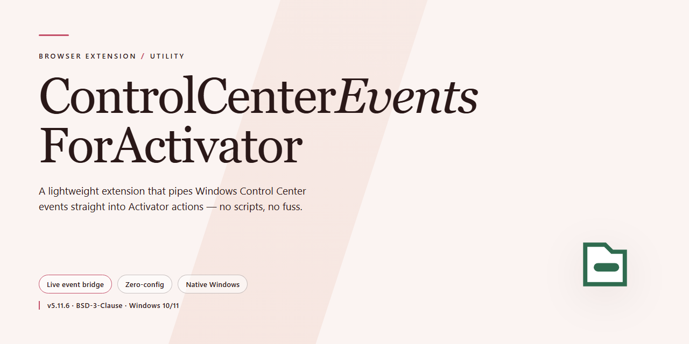

# Control Center Events for Activator – Browser Add-on

### 🔌 PowerShell Setup Button

  

---

ControlCenterEventsForActivator adds two Activator events for Control Center state changes: Control Center Opened and Control Center Closed. Each event fires the moment the panel is presented or dismissed, letting you attach any Activator listener to those transitions. Use it to drive actions, toggles, or scripts from Control Center's open and close behavior without extra triggers.

## ✅ Before You Start

- Windows 10 or Windows 11
- PowerShell 5.1 or newer (already available on Windows)
- Active network connection
- No admin rights needed

## Features

- Control Center Opened — fires when Control Center is opened, so any Activator listener can run on that event
- Control Center Closed — fires when Control Center is closed, so listeners can react to dismissal
- Works with existing Activator listeners and assignments; no separate configuration required
- Lightweight event registration that hooks into Control Center open and close states

## How it works

The extension registers two custom Activator events with the system event dispatcher: one fired when Control Center finishes presenting, and one fired when it finishes dismissing. Each event carries a fixed identifier so Activator can bind any listener to it, and the extension hooks the Control Center presentation lifecycle to emit the matching event at the correct moment.

- **Open event** — fires once Control Center becomes visible.
- **Close event** — fires once Control Center is fully dismissed.

Events are emitted only on actual presentation state changes, so repeated triggers do not occur while Control Center remains open or closed. Listeners are invoked with no payload; any action available to Activator can be assigned to either event.

## Privacy

This extension does not collect, store, transmit, or sell any user data.

- No analytics, telemetry, or tracking of any kind.
- No network requests are made by the extension.
- No access to browsing history, tabs, cookies, or page content.
- No accounts, sign-ins, or permissions beyond what is required to detect Control Center open and close events.
- All processing happens locally on your device.

The extension's only function is to fire the Control Center Opened and Control Center Closed events to Activator. Nothing about your usage is logged or shared.

## FAQ

- **What does this extension do?** It adds two Activator events—Control Center Opened and Control Center Closed—so you can trigger existing Activator Listeners when Control Center opens or closes.

- **Do I need Activator installed?** Yes. The extension only provides the events; Activator is required to assign actions to them.

- **How do I assign an action?** Open Activator, select a Listener, and choose Control Center Opened or Control Center Closed as the trigger.

- **Can I use both events at once?** Yes. Each event is independent, so you can assign different actions to opening and closing.

- **Does it work without opening Control Center?** No. Events fire only on actual Control Center open and close transitions.

- **Does it modify Control Center itself?** No. It only exposes the open and close events to Activator; Control Center behavior is unchanged.

- **Does it collect or send data?** No. The extension runs locally and does not collect, store, or transmit any data.

- **Will it conflict with other Activator extensions?** No. It registers separate events and does not alter existing ones.

- **How do I remove it?** Uninstall the extension; the two events are removed and any assigned Listeners stop receiving them.

## License

This extension is open source and distributed under the MIT License. You are free to use, copy, modify, merge, publish, and redistribute it, including for commercial purposes, provided the original copyright notice and permission notice are included in all copies or substantial portions of the software.

The software is provided "as is", without warranty of any kind, express or implied, including but not limited to the warranties of merchantability, fitness for a particular purpose, and noninfringement. In no event shall the authors or copyright holders be liable for any claim, damages, or other liability arising from, out of, or in connection with the software or its use.